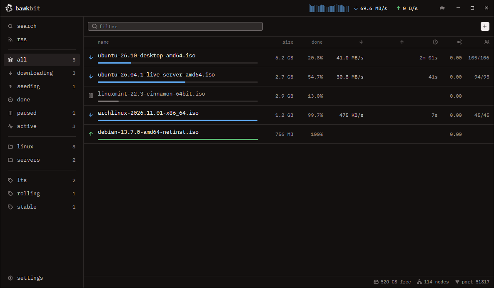
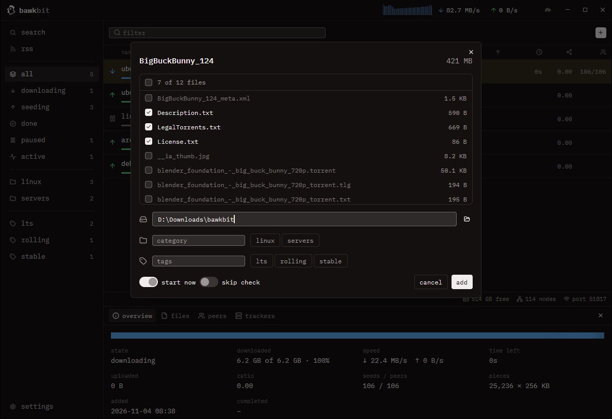
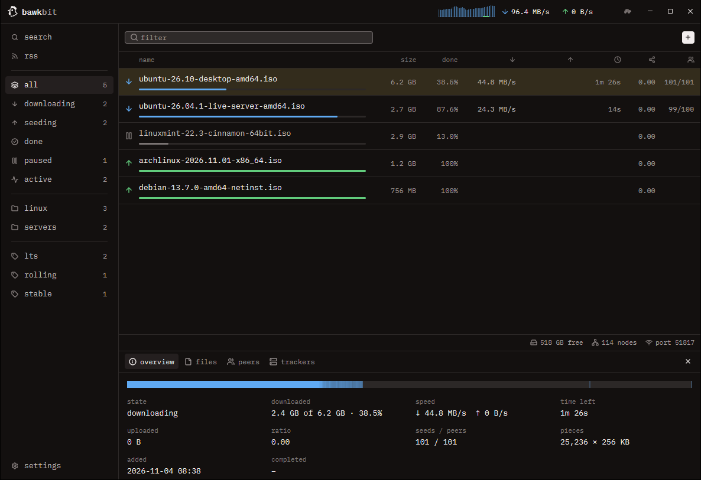
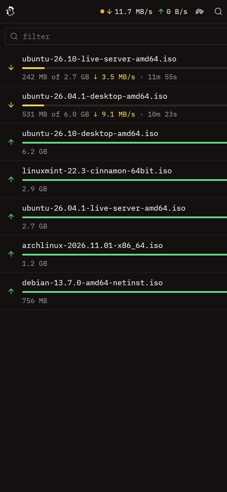

<p align="center">
  
</p>

<h1 align="center">bawkbit</h1>

<p align="center">
  A small torrent app for Windows and Linux.<br>
  Use it on your computer, or from the browser on your phone.
</p>

<p align="center">
  <a href="https://github.com/juddisjudd/bawkbit/releases/latest"><b>Download</b></a> ·
  <a href="#get-started">Get started</a> ·
  <a href="#guides">Guides</a> ·
  <a href="#keyboard-shortcuts">Shortcuts</a> ·
  <a href="#for-developers">For developers</a>
</p>



## Download

It takes about 2 minutes.

1. Open the [releases page](https://github.com/juddisjudd/bawkbit/releases/latest).
2. Download the file for your computer:

   | Your computer | File | Then |
   | --- | --- | --- |
   | Windows 10 or 11, 64-bit | `bawkbit-…-windows-x64-setup.exe` | Run it. You do not need to be an administrator. |
   | Linux | `bawkbit-…-linux-x64.AppImage` | Run `chmod +x bawkbit-*.AppImage`, then run the file. |

3. Start bawkbit.

**Windows says "Windows protected your PC"?** bawkbit is not signed with a paid certificate, so Windows may warn you the first time. Click **More info**, then **Run anyway**.

<details>
<summary>Other downloads: zip, .deb, .rpm, server, Docker</summary>

| For | File | Install |
| --- | --- | --- |
| Windows, no installer | `bawkbit-…-windows-x64.zip` | Unzip it anywhere. Start `bawkbit.exe`. |
| Debian, Ubuntu, Mint | `bawkbit_…_amd64.deb` | `sudo apt install ./bawkbit_*.deb` |
| Fedora | `bawkbit-….x86_64.rpm` | `sudo dnf install ./bawkbit-*.rpm` |
| A Linux server | `bawkbitd-…-linux-x64.tar.gz` | Unpack it, then run `./bawkbitd`. |
| Docker | `ghcr.io/juddisjudd/bawkbit` | See [Run it on a server](#run-it-on-a-server). |

</details>

The Linux downloads need a 64-bit system from 2022 or later (glibc 2.35), such as Ubuntu 22.04 or Debian 12. Each download has a `.sha256` file next to it. Use it to check that the file arrived whole.

## Get started

1. Press **+**. Paste a magnet link (a link that starts with `magnet:`), or drop a `.torrent` file on the window.
2. Tick the files you want, then press **add**.
3. The download starts. When it finishes, the bar turns green and bawkbit shares the file with others. This is called seeding.

Downloads go to a `bawkbit` folder inside your Downloads folder. To change it, open **settings → downloads**.

To open magnet links and `.torrent` files from your browser in bawkbit on Windows, open **settings → downloads** and press **open them with bawkbit**.



## What it does

### Add torrents

- **Add** magnet links, links to `.torrent` files, and `.torrent` files. You see the file list first and pick what to download.
- **Add magnets straight away**, without the file list: **settings → downloads → add magnets without asking**.
- **Skip check**: in the add window, trust files that are already complete, such as for cross-seeding. A spot check still runs. If it finds a bad piece, a full check takes over.
- **Watch folder**: put `.torrent` files in it and bawkbit adds them.
- **One window**: open a magnet link while bawkbit runs, and the open window gets it.

### Find torrents

- **Search** your Prowlarr or Jackett. Results from every tracker show in one list.
- **RSS** feeds, with rules that add new items for you.

### Keep things tidy

- **Categories**, each with its own folder and its own shared speed limits.
- **Tags**. Right-click a category or tag in the sidebar to rename it.
- **Filters**: show the list by status, category and tag at the same time.
- **Details** for each torrent: a piece map, files with progress and on/off per file, peers, and trackers you can add and remove.



### Control speed and sharing

- **Speed limits**. The turtle in the title bar switches to slower alternative limits. A schedule can switch for you.
- **A queue**: only a set number of downloads run at once. The rest wait their turn.
- **Seeding goals**: stop sharing at a ratio or after a set time.
- **Per torrent**, from the right-click menu: force start past the queue, check again, no upload, its own speed limits, and more trackers. A torrent keeps what it has downloaded when you add trackers.
- **More ways to connect**: DHT and peer exchange find peers without a tracker. UPnP opens the port on your router for you. uTP is off until you turn it on under **settings → connection**.

### Runs quietly in the background

- **When a download finishes**: a notification, and a program you choose.
- **The tray**: bawkbit keeps running there with the window closed. It can start when you log in.
- **Updates itself** from the releases page. It checks each download's checksum first.
- **Backup**: export the settings, categories, tags and RSS to a file. Import them on another computer (**settings → about**). Passwords and API keys stay out of the file.
- **Themes**: dark, light, follow your system, or one of 30 named themes.

## Guides

### Use it from your phone

It takes about 1 minute.

1. In the desktop app, open **settings → web ui**.
2. Set a password and press **save**.
3. Turn on **web ui**.
4. Open the address it shows.

To reach it from your phone or another computer, keep the address `0.0.0.0`. Then open `http://<this computer's IP>:8228` on that device. With `127.0.0.1`, only this computer can reach it.

<p align="center">
  
</p>

### Search for torrents

It takes about 5 minutes if Prowlarr or Jackett already runs.

bawkbit searches through [Prowlarr](https://prowlarr.com) or [Jackett](https://github.com/Jackett/Jackett). These apps talk to torrent sites for you. Sonarr and Radarr use them too. bawkbit has no site code of its own, so you pick the trackers, and Prowlarr or Jackett keeps them working when the sites change.

1. Open **settings → search** and press **add prowlarr** or **add jackett**.
2. Type its address, such as `http://tower:9696`, and its API key. Prowlarr shows the key under **settings → general**. Jackett shows it at the top right of its dashboard.
3. Press **test**. It says how many indexers it found.
4. Open **search**, type a name and press Enter.
5. Click a result to add it.

Results come from every source you turned on, all at once. A torrent that several trackers list shows once. To narrow the results, type in the refine box:

- `-word` leaves out a word.
- `>1GB` or `<500MB` limits the size.

### Get new episodes on their own (RSS)

It takes about 3 minutes.

bawkbit reads RSS and Atom feeds, including the feeds that Prowlarr, Jackett and most trackers give out. It adds new items that match your rules.

1. Open **rss**. Paste a feed address into the box at the top left and press Enter.
2. Open **rules** and press **new rule**.
3. Type a name and the words a title must contain, such as `show 1080p`. `|` separates choices and `*` matches anything. To write a regex instead, turn on **regular expressions**.
4. Pick a category or folder, then press **save**.

The list under the rule now shows what in the feeds matches.

- A rule takes only items that arrive after you make it. It never adds a whole feed's backlog.
- To add an item by hand, click it in a feed.
- **each episode once** skips an episode the rule already took, such as `S01E02` in a second quality.
- bawkbit checks each feed every 30 minutes. Change it under **settings → downloads**.

### Run a program when a download finishes

The desktop app shows a notification. To run a program as well, type it under **settings → downloads → when one finishes, run**. For example:

```
C:\scripts\done.bat "%F" "%L"
```

bawkbit swaps each code for a detail of the finished torrent. The program also gets most of them as environment variables.

About the torrent:

| Code | Variable | Means |
| --- | --- | --- |
| `%N` | `BAWKBIT_NAME` | its name |
| `%L` | `BAWKBIT_CATEGORY` | its category |
| `%G` | `BAWKBIT_TAGS` | its tags |
| `%I` | `BAWKBIT_ID` | its id |

About its files:

| Code | Variable | Means |
| --- | --- | --- |
| `%F` | `BAWKBIT_CONTENT` | its file or folder |
| `%D` | `BAWKBIT_FOLDER` | the folder that holds it |
| `%Z` | `BAWKBIT_SIZE` | its size in bytes |
| `%C` | none | how many files it has |

- bawkbit starts the program directly, without a shell. So a torrent's name can never run as a command.
- The web UI shows this setting but cannot change it, because anyone who can change it can run programs on the computer.
- With `bawkbitd`, stop it first, then set `on_finish` in `settings.json`.

### Keep it in the tray

bawkbit puts an icon in the system tray. From its menu you can:

- open the window
- pause or resume everything
- turn the alternative speeds on and off

Closing the window leaves bawkbit downloading and seeding in the tray. To quit, use the tray menu.

Under **settings → app** you can:

- turn the tray icon off
- make closing the window quit
- start bawkbit when you log in. It then starts in the tray.

On Linux the icon needs a desktop with a system tray, such as KDE, or GNOME with the AppIndicator extension. Without one, closing the window quits.

### Update bawkbit

bawkbit asks GitHub for a new version once a day. When there is one, a dot shows on **settings**.

1. Open **settings → about**.
2. Press **update**.
3. Press **restart now**.

bawkbit checks the download against its SHA-256 checksum before it replaces anything. Your torrents carry on after the restart.

This works for the Windows installer, the Windows zip and the AppImage. For the others:

- `.deb` and `.rpm`: update with your package manager.
- Docker: pull the new image.

To turn off the daily check, open **settings → about**.

### Run it on a server

`bawkbitd` is the engine and the web UI, with no window.

1. Start `bawkbitd`. On first start it prints a password for the web UI:

   ```
   web UI login: admin / 9pp78qhhevuyef
   ```

2. Open `http://<server>:8228` and log in.

To get a new password, run `bawkbitd --new-password`.

With Docker:

```sh
docker run -d --name bawkbit --restart unless-stopped \
  -p 8228:8228 -p 51413:51413 \
  -v ./config:/config -v ./downloads:/downloads \
  ghcr.io/juddisjudd/bawkbit:latest
docker logs bawkbit          # shows the web UI password
```

- Settings live in `./config`, downloads in `./downloads`.
- Forward TCP port 51413 on your router, so other peers can reach you.
- The `edge` tag follows every change on `main`.
- To build the image yourself, run `docker compose -f packaging/docker/docker-compose.yml up -d` from the repository root.

## Keyboard shortcuts

Add and find:

| Press | To |
| --- | --- |
| `Ctrl+O` | add `.torrent` files |
| `Ctrl+V` | add the magnet link on the clipboard |
| `Ctrl+A` | select every torrent in the list |
| `Ctrl+F` | filter the list by name |
| `Esc` | close the details |

Act on the selected torrents:

| Press | To |
| --- | --- |
| `Space` | pause or resume them |
| `Delete` | remove them and keep their files |
| `Shift+Delete` | remove them and delete their files |

Double-click a torrent to open its folder. Right-click it for everything else.

## Where your files and settings are

Your downloads go to `Downloads\bawkbit` on Windows and `~/Downloads/bawkbit` on Linux. Change it under **settings → downloads**.

| Settings file | Windows | Linux |
| --- | --- | --- |
| Engine settings | `%APPDATA%\bawkbit\settings.json` | `~/.config/bawkbit/settings.json` |
| Categories, tags and torrent history | `%APPDATA%\bawkbit\torrents.json` | `~/.config/bawkbit/torrents.json` |
| RSS feeds and rules | `%APPDATA%\bawkbit\rss.json` | `~/.config/bawkbit/rss.json` |
| The torrents themselves, for resuming | `%APPDATA%\bawkbit\session` | `~/.config/bawkbit/session` |
| Desktop app look and sort order | `%APPDATA%\bawkbit\desktop.json` | `~/.config/bawkbit/desktop.json` |

To keep a second copy's settings apart from your own, set `BAWKBIT_HOME` to a folder.

## For developers

### Build

You need Rust 1.92 or later and [bun](https://bun.sh).

- On Windows you also need the MSVC toolchain.
- On Linux you also need a C compiler and the development files for fontconfig, Wayland, X11 and xkbcommon. On Debian and Ubuntu:

  ```sh
  sudo apt install build-essential pkg-config libfontconfig-dev libwayland-dev libx11-xcb-dev libxkbcommon-x11-dev
  ```

Build the web UI first, because the Rust build puts it inside the program:

```sh
cd web && bun install && bun run build && cd ..
cargo run --release              # the desktop app
cargo run --release -p bawkbitd  # the engine and web UI without a window
cargo test --workspace           # the tests
```

The first build compiles GPUI and takes a few minutes. Without `web/dist`, the web UI shows a page that says it is not built.

To see what the desktop app does, set `LOG_LEVEL` and `LOG_FILE`. In PowerShell:

```powershell
$env:LOG_LEVEL = "DEBUG"; $env:LOG_FILE = "$env:TEMP\bawkbit.log"; cargo run
```

`bawkbitd` logs to the terminal. For more, set `RUST_LOG=debug`.

### How it fits together

The engine and its servers:

| Part | What it is |
| --- | --- |
| [`crates/core`](crates/core) | The engine: torrents, settings, the queue, seeding goals, the schedule, the watch folder and RSS. Every client talks to it through the types in `api.rs`. |
| [`crates/web`](crates/web) | The HTTP API and the web UI server, with login, live updates and the built web UI inside. |
| [`crates/daemon`](crates/daemon) | `bawkbitd`, the engine and the web UI without a window. |

The apps, and code from others:

| Part | What it is |
| --- | --- |
| [`src`](src) | The desktop app, drawn with GPUI. |
| [`web`](web) | The web UI, in Svelte. See [web/README.md](web/README.md). |
| [`vendor`](vendor) | librqbit with a small patch for per-torrent upload and speed limits, and limits shared by a category. See [vendor/README.md](vendor/README.md). |

### Builds and releases

The [build workflow](.github/workflows/build.yml) runs on every push to `main` and every pull request. It checks the web UI, then formats, lints and tests the Rust code on Windows and Linux, and packages everything. Download the packages from the run's page under **Artifacts**. Each push to `main` also publishes the `edge` Docker image.

To publish a version, run this from a clean `main`:

```powershell
.\scripts\release.ps1 -Version 0.2.0
```

It sets the version in `Cargo.toml` and `web/package.json`, commits, tags `v0.2.0` and pushes. Then the workflow:

- publishes the Windows installer and zip, the AppImage, the `.deb`, the `.rpm` and the tar.gz files on the releases page, each with its SHA-256 checksum
- pushes the Docker image as `0.2.0`, `0.2` and `latest`
- fails the build if the tag does not match the version in `Cargo.toml`

The Windows installer comes from [`packaging/windows`](packaging/windows) and the Linux packages from [`packaging/linux/package.sh`](packaging/linux/package.sh).

### The HTTP API

The web UI uses this API, and so can your scripts. Log in with `POST /api/login` and `{"username", "password"}`; the answer sets a cookie. Send `content-type: application/json` with every write. The request and answer shapes are in [`crates/core/src/api.rs`](crates/core/src/api.rs). A torrent's `id` is its info hash.

Read what is going on:

| Request | Does |
| --- | --- |
| `GET /api/snapshot` | every torrent, the speeds, categories and tags |
| `GET /api/events` | the same snapshot once a second, and a `finished` event for each finished download, as server-sent events |
| `GET /api/torrents/{id}` | one torrent's files, peers, trackers and piece map |

Add and change torrents:

| Request | Does |
| --- | --- |
| `POST /api/preview` | reads a magnet link or `.torrent` file without adding it |
| `POST /api/torrents` | adds a torrent; `skip_check` trusts files already on disk |
| `POST /api/actions` | pause, resume, force start, re-check, remove, set files, trackers, no upload, speed limits, categories and their limits, tags, renames and the alternative limits |

Search and RSS:

| Request | Does |
| --- | --- |
| `POST /api/search` | searches every turned-on Prowlarr and Jackett |
| `POST /api/indexers/test` | checks a Prowlarr or Jackett address and key |
| `GET` or `POST /api/rss` | reads the feeds and rules, or changes them |
| `POST /api/rss/matches` | what a rule would take from the feeds now |

Settings and backup:

| Request | Does |
| --- | --- |
| `GET` or `PUT /api/settings` | reads or changes the engine settings |
| `GET` or `POST /api/backup` | exports the settings, categories, tags and RSS, or imports them |

## Credits

- [librqbit](https://github.com/ikatson/rqbit) (Apache-2.0) is the BitTorrent engine, with the small patch in [`vendor`](vendor).
- [GPUI Kit](https://github.com/longbridge/gpui-kit) (Apache-2.0) and Zed's GPUI draw the desktop app.
- [axum](https://github.com/tokio-rs/axum) (MIT) serves the web UI. [Svelte](https://svelte.dev) (MIT) builds it.
- [IBM Plex Mono](https://github.com/IBM/plex) (SIL Open Font License, `assets/fonts/OFL.txt`) is the typeface.
- [Lucide](https://lucide.dev) (ISC) icons.

bawkbit takes its ideas from two older clients:

- From [qBittorrent](https://github.com/qbittorrent/qBittorrent): categories with save paths, tags, the filter sidebar, alternative speed limits with a schedule, the queue and the built-in web UI.
- From [Deluge](https://github.com/deluge-torrent/deluge): the split between the engine and the windows that show it. So the same engine runs behind the desktop app, the web UI and the headless daemon.

## License

[AGPL-3.0](LICENSE).
